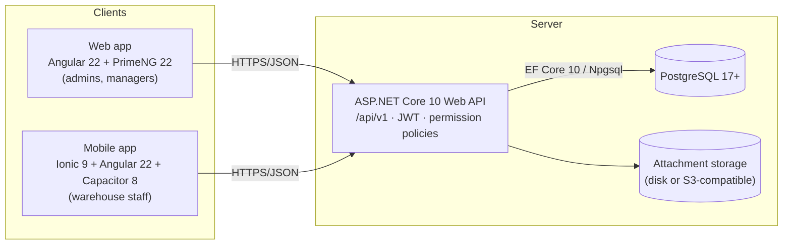

# 01 — Architecture Proposal

Status: **Draft for review (Phase 1)** · Date: 2026-10-09

## 1. Context

One warehouse company operates the system. It stores products and dispatches them to multiple **customer companies**. The first deployment has one warehouse branch, but every table, query and permission is warehouse-scoped from day one, so adding a branch is a data change and does not require a schema redesign.

This is **not** a multi-tenant SaaS. Customers are business records that receive dispatches. They are not tenants, and in v1 they don't log in (see open question Q2).

## 2. System overview



* **One API** serves both apps. The mobile app is online-only: it has no local stock state and no offline queue.
* **Shared TypeScript library** (`@wh/shared`) holds the DTO models, typed API services, auth interceptor and validators that both apps use.
* **Business rules live only in the API.** Frontends hide buttons for usability, but every rule and permission is enforced server-side.

## 3. Backend architecture

Clean/layered architecture, using the project names from `Claude.md`:

| Project | Responsibility | Depends on |
|---|---|---|
| `Inventory.Domain` | Entities, value objects, enums, domain rules (dispatch state machine, balance invariants), domain errors. No EF or ASP.NET references. | — |
| `Inventory.Application` | Use cases (commands/queries as plain handler classes), DTOs, FluentValidation validators, interfaces (`ICurrentUser`, `IWarehouseAccess`, `IClock`, `IUnitOfWork`), authorization checks. | Domain |
| `Inventory.Infrastructure` | EF Core `DbContext`, configurations, migrations, repositories, row locking, idempotency store, identity/token services, file storage, audit interceptor. | Application |
| `Inventory.Api` | Controllers (`/api/v1/...`), auth setup, permission policies, ProblemDetails, rate limiting, OpenAPI/Swagger, Serilog, health checks. | Application, Infrastructure |
| `Inventory.Tests` | xUnit unit tests: domain rules and state machine. | Domain, Application |
| `Inventory.IntegrationTests` | xUnit + Testcontainers (real PostgreSQL): stock accounting, concurrency, idempotency, authorization. | Api |

Library choices (all free, permissive licences):

* **No MediatR or AutoMapper.** Both moved to commercial licences in 2025. Use plain handler classes and hand-written mapping, which stays explicit and testable.
* FluentValidation for request validation, Serilog for structured logging, and `Asp.Versioning.Mvc` for `/api/v1`.
* OpenAPI document via `Microsoft.AspNetCore.OpenApi`, with Swagger UI via `Swashbuckle.AspNetCore.SwaggerUI`.

### Request pipeline (for every protected call)

1. Validate the JWT and resolve `ICurrentUser` (user id, permissions, allowed warehouse ids) **from the server**. Nothing is trusted from the payload.
2. Check the permission policy (`[HasPermission("dispatches.approve")]`).
3. Validate the request (FluentValidation, then ProblemDetails 400).
4. Handler checks warehouse access for the target record (`IWarehouseAccess.EnsureCanAccess(warehouseId)`), returning 404 for records outside the user's scope so their existence isn't leaked.
5. Command handlers run in a transaction. They lock rows where stock is involved, enforce the state machine, write the audit log, then commit.

## 4. Authentication and authorization

**Proposed (pending Q12):** ASP.NET Core Identity user store in PostgreSQL. It issues short-lived JWT access tokens (15 min) and rotating refresh tokens (stored hashed, revocable, with reuse detection).

* Web: access token held in memory; refresh token in an `HttpOnly; Secure; SameSite=Strict` cookie.
* Mobile: refresh token in iOS Keychain / Android Keystore via `@aparajita/capacitor-secure-storage`.
* Passwords use the Identity PBKDF2 hasher. Login endpoints are rate-limited, and accounts lock out after repeated failures.
* Alternative: Microsoft Entra ID (OIDC) sign-in, if staff already have Microsoft 365 accounts.

**Authorization model**

* `Role` → `RolePermission` → `Permission` (seeded codes such as `inventory.adjust`). Users get roles. Policies check **permissions, never role names**, so roles stay re-configurable.
* `UserWarehouseAccess` lists the warehouses a user may act in. Administrators get an `AllWarehouses` flag instead of per-row grants.
* Seeded roles:

| Permission | Administrator | Warehouse Manager | Warehouse Operator |
|---|:-:|:-:|:-:|
| users.manage, settings.manage, customers.manage, warehouses.manage | ✔ | | |
| products.read | ✔ | ✔ | ✔ |
| products.manage | ✔ | ✔ | |
| inventory.read | ✔ | ✔ | ✔ |
| inventory.receive | ✔ | ✔ | ✔ (record qty) |
| inventory.receive.post | ✔ | ✔ | |
| inventory.adjust (request) | ✔ | ✔ | ✔ (optional) |
| inventory.adjust.approve | ✔ | ✔ | |
| inventory.transfer | ✔ | ✔ | |
| dispatches.read | ✔ | ✔ | ✔ |
| dispatches.create | ✔ | ✔ | ✔ |
| dispatches.approve | ✔ | ✔ | |
| dispatches.pick | | ✔ | ✔ |
| dispatches.ship | ✔ | ✔ | per-user grant |
| dispatches.deliver | ✔ | ✔ | ✔ |
| dispatches.cancel | ✔ | ✔ | |
| reports.read, audit.read | ✔ | ✔ (reports) | |

* **Segregation of duties** (configurable, default ON): a user cannot approve a dispatch they created, and cannot approve an adjustment they requested.

## 5. Frontend architecture

One Angular CLI workspace containing three projects, all on the same Angular major version:

* `projects/shared`: an Angular library with DTO interfaces, typed `*ApiService`s over `HttpClient`, auth + error interceptors, a ProblemDetails parser, common validators and an idempotency-key helper.
* `projects/web`: standalone components, lazy feature routes (`/products`, `/inventory`, `/dispatches`…), PrimeNG components (Table with lazy loading for server-side paging, Dialog, Drawer, Select, AutoComplete, InputNumber, DatePicker, Tag, Toast, ConfirmDialog, FileUpload), signals for state, reactive forms and strict TypeScript.
* `projects/mobile`: Ionic standalone components and Capacitor 8 for Android/iOS. Screens: login → warehouse picker → home (scan / search / my picking tasks / receipts / recent activity).

Every stock-changing button disables itself while a request is in flight and sends an `Idempotency-Key` header. The UI shows success only after the API confirms.

## 6. Barcode scanning (recommendation)

**Primary choice: `@capacitor-mlkit/barcode-scanning` v8.2.x (Capawesome)**

* Maintained (last published Sept 2026). Peer dependency `@capacitor/core >= 8`. Android and iOS.
* Uses Google ML Kit on device, so it works without network access to a scanning service. Supports 1D codes (EAN-13/8, UPC-A/E, Code 128, Code 39, ITF) and 2D codes (QR, DataMatrix, PDF417).
* Offers both a ready-made scanner UI on Android (Google Code Scanner, no camera permission needed) and a custom overlay mode with torch control. Provides `checkPermissions` / `requestPermissions` for camera-permission handling.
* Restrict accepted formats to those actually used (faster, fewer misreads).

**Fallbacks, always available:**

1. Manual code entry or product search.
2. **Keyboard-wedge input.** If staff use rugged scanners (Zebra, Honeywell) or Bluetooth ring scanners, those "type" the barcode into a focused input. The scan screen will accept both camera and wedge input. This matters for Q10.

Alternative considered: the official `@capacitor/barcode-scanner` (Ionic/OutSystems). It is viable, but it has fewer format and UI controls, so it's kept as plan B.

**Verification gate:** before Phase 7, a spike app is installed on the actual target phones (Android and iOS) to scan real product labels under warehouse lighting. The choice is confirmed only after that test.

Duplicate-scan protection works at two levels. Client side, identical codes within 1.5 s are ignored. Server side, every pick/receive confirmation carries a client-generated `scanId` (UUID) with a unique constraint. A scan only *identifies* the product; quantities are always validated by the API.

## 7. Pinned versions (proposed; locked in Phase 2 via lock files)

Checked against npm/NuGet on 2026-10-09.

| Component | Version | Notes |
|---|---|---|
| .NET SDK / ASP.NET Core | **10.0.x (LTS)** | Supported to Nov 2028 |
| EF Core | 10.0.x | |
| Npgsql.EntityFrameworkCore.PostgreSQL | 10.0.x | Matches EF Core 10 |
| PostgreSQL | **17** (18 acceptable) | Needs ≥15 for `NULLS NOT DISTINCT` |
| Node.js | 22 LTS (or 24 LTS) | 22.23 present on the dev VM |
| Angular | **22.2.x** | |
| PrimeNG / PrimeIcons / @primeuix/themes | **22.1.x** / 7.x / 3.0.x | PrimeNG 22 peer: Angular ^22.1 |
| Ionic Angular | 9.0.x | Peer: Angular ≥18 |
| Capacitor (core/android/ios) | **8.5.x** | |
| @capacitor-mlkit/barcode-scanning | 8.2.x | |
| @aparajita/capacitor-secure-storage | 8.0.x | Token storage |
| Test: backend | xUnit v3, Testcontainers.PostgreSql, Respawn | Integration tests need Docker |
| Test: frontend | Vitest (Angular default), Playwright for E2E | |

## 8. Repository layout (Phase 2)

```
Warehousing/
├── Claude.md
├── docs/                         ← these documents
├── backend/
│   ├── Inventory.slnx
│   ├── src/Inventory.{Domain,Application,Infrastructure,Api}/
│   └── tests/Inventory.{Tests,IntegrationTests}/
├── frontend/                     ← Angular workspace (npm)
│   ├── angular.json
│   └── projects/{shared,web,mobile}/
├── deploy/docker-compose.dev.yml ← PostgreSQL for local dev
└── .github/workflows/ci.yml      ← build + test (optional)
```

## 9. Security and reliability checklist

HTTPS only (HSTS); CORS limited to the web origin(s). Secrets come from environment variables or user-secrets and are never stored in git. Upload validation covers size limit, extension and magic-byte whitelist (PDF, JPG, PNG), random storage names, and downloads only through an authorized endpoint. Rate limits apply on `/auth`. Serilog redacts tokens and passwords. Every material action writes an `AuditLog` row. Health checks are exposed at `/health`. Daily `pg_dump` plus WAL archiving are documented in Phase 9.

## 10. Development environment findings (2026-10-09)

* The repo folder contains only `Claude.md` and is **not a git repository** yet. Phase 2 will start with `git init` and a `.gitignore`.
* The folder lives under **OneDrive**. `node_modules`, `bin` and `obj` hold tens of thousands of files that OneDrive will try to sync and sometimes lock mid-build. **Recommend moving the repo** to e.g. `C:\dev\Warehousing` (and pushing to GitHub), or at least excluding those folders from sync.
* Your Windows machine's toolchain could not be checked from here. Required: .NET 10 SDK, Node 22/24, PostgreSQL 17 (or Docker Desktop), Android Studio for Android builds. **iOS builds require a Mac with Xcode** (or a cloud Mac build service).
