# 02 — Data Model

Status: **Draft for review (Phase 1)**. Items marked ◇ depend on open questions in `04-plan-and-open-questions.md`.

**Decided 2026-10-09:**
* Stock is owned by the warehouse company, so there is no owner dimension.
* No customer logins in v1.
* **Lots, expiry dates, bin locations and pack units are all in v1.**
* Partial shipments are allowed; the shipper chooses close-short or backorder.

**Stock key = warehouse × location (bin) × product × lot.** All quantities are stored in the product's **base unit**. Packs are converted on entry.

Conventions: PostgreSQL `snake_case` tables. `uuid` primary keys (UUID v7, time-ordered). All timestamps are `timestamptz` in UTC. Quantities are `numeric(18,3)`, money (if ever needed) is `numeric(18,2)`. Every mutable row has `created_at/by`, `updated_at/by` and an optimistic concurrency token (PostgreSQL `xmin`). Master data uses soft-deactivation (`is_active`) rather than deletes. **No cascade deletes** on any inventory, dispatch or audit table.

## 1. ER diagram

```mermaid
erDiagram
  USER ||--o{ USER_ROLE : has
  ROLE ||--o{ USER_ROLE : ""
  ROLE ||--o{ ROLE_PERMISSION : grants
  PERMISSION ||--o{ ROLE_PERMISSION : ""
  USER ||--o{ USER_WAREHOUSE_ACCESS : "may act in"
  WAREHOUSE ||--o{ USER_WAREHOUSE_ACCESS : ""

  CUSTOMER ||--o{ CUSTOMER_ADDRESS : "delivers to"
  PRODUCT_CATEGORY ||--o{ PRODUCT : groups
  UNIT_OF_MEASURE ||--o{ PRODUCT : "base unit"
  PRODUCT ||--o{ PRODUCT_BARCODE : "identified by"

  PRODUCT ||--o{ PRODUCT_UNIT : "packs (carton=12)"
  UNIT_OF_MEASURE ||--o{ PRODUCT_UNIT : ""
  PRODUCT_UNIT |o--o{ PRODUCT_BARCODE : "barcode per pack"
  PRODUCT ||--o{ PRODUCT_LOT : "batches"
  WAREHOUSE ||--o{ WAREHOUSE_LOCATION : "bins"

  WAREHOUSE ||--o{ INVENTORY_BALANCE : holds
  PRODUCT ||--o{ INVENTORY_BALANCE : ""
  WAREHOUSE_LOCATION ||--o{ INVENTORY_BALANCE : "in bin"
  PRODUCT_LOT |o--o{ INVENTORY_BALANCE : "of lot"
  INVENTORY_BALANCE ||--o{ INVENTORY_MOVEMENT : "ledger of"
  INVENTORY_BALANCE ||--o{ STOCK_RESERVATION : "reserved from"

  SUPPLIER |o--o{ GOODS_RECEIPT : "from (optional)"
  WAREHOUSE ||--o{ GOODS_RECEIPT : into
  GOODS_RECEIPT ||--|{ GOODS_RECEIPT_LINE : contains
  PRODUCT ||--o{ GOODS_RECEIPT_LINE : ""

  WAREHOUSE ||--o{ STOCK_ADJUSTMENT : in
  STOCK_ADJUSTMENT ||--|{ STOCK_ADJUSTMENT_LINE : contains

  WAREHOUSE ||--o{ STOCK_TRANSFER : "from / to"
  STOCK_TRANSFER ||--|{ STOCK_TRANSFER_LINE : contains

  CUSTOMER ||--o{ DISPATCH : receives
  CUSTOMER_ADDRESS |o--o{ DISPATCH : "ship-to"
  WAREHOUSE ||--o{ DISPATCH : "source"
  DISPATCH ||--|{ DISPATCH_LINE : contains
  PRODUCT ||--o{ DISPATCH_LINE : ""
  DISPATCH_LINE ||--o{ STOCK_RESERVATION : "reserves via"
  DISPATCH_LINE ||--o{ PICK_CONFIRMATION : "picked by"
  DISPATCH ||--o{ DISPATCH_STATUS_HISTORY : "transitions"
  DISPATCH ||--o{ DISPATCH_DISCREPANCY : reports
  DISPATCH |o--o| DISPATCH : "backorder of"
  DISPATCH ||--o| PROOF_OF_DELIVERY : "delivered with"
  DISPATCH ||--o{ ATTACHMENT : documents
  USER ||--o{ AUDIT_LOG : "acts in"
```

## 2. Entities

### Identity and access
| Entity | Key fields | Rules |
|---|---|---|
| **User** (ASP.NET Identity) | id, email (unique), display_name, is_active, all_warehouses (bool), last_login_at | Deactivate, never delete. |
| **Role** | id, code (unique), name | Seeded: ADMIN, WH_MANAGER, WH_OPERATOR. |
| **Permission** | id, code (unique, e.g. `dispatches.ship`), description | Seeded from code; read-only in the UI. |
| **RolePermission** | role_id, permission_id | PK (role_id, permission_id). |
| **UserRole** | user_id, role_id | PK (user_id, role_id). |
| **UserWarehouseAccess** | user_id, warehouse_id, granted_at/by | PK (user_id, warehouse_id). |
| **RefreshToken** | id, user_id, token_hash, expires_at, revoked_at, replaced_by_id, device_info | Rotation with reuse detection. |

### Master data
| Entity | Key fields | Rules |
|---|---|---|
| **Warehouse** | id, code (unique), name, address lines, city, country, phone, email, is_active | One seeded (`MAIN`); never referenced by hard-coded id. |
| **WarehouseLocation** | id, warehouse_id, code (e.g. `A-01-03`), zone, type (STORAGE / RECEIVING / DISPATCH_DOCK / QUARANTINE), barcode, is_pickable, is_active | Unique (warehouse_id, code). Each warehouse is seeded with RECEIVING, DOCK and QUARANTINE locations. Bin labels can be scanned. |
| **Customer** | id, reference (unique), company_name, contact_name, phone, email, billing address, notes, is_active | |
| **CustomerAddress** | id, customer_id, label, address lines, city, country, contact, phone, is_default, is_active | Dispatches snapshot the address at submit time. |
| **Supplier** ◇ | id, code (unique), name, contact fields, is_active | Optional on receipts (Q11). |
| **ProductCategory** | id, code (unique), name, parent_id (nullable), is_active | Optional hierarchy. |
| **UnitOfMeasure** | id, code (unique, e.g. `EA`, `KG`), name, decimals_allowed (0–3) | Controls quantity precision per product (Q9). |
| **Product** | id, sku (unique), name, description, category_id, base_uom_id, min_stock_qty, image_attachment_id, is_lot_tracked, has_expiry, shelf_life_days, is_active | SKU is unique and immutable once stock exists. `is_lot_tracked` / `has_expiry` are per product, so a product without lots needs no lot entry. |
| **ProductUnit** | id, product_id, uom_id (e.g. `CTN`), factor_to_base (e.g. 12), is_default_for_receipt, is_default_for_dispatch | UNIQUE (product_id, uom_id). The base unit has factor 1. |
| **ProductBarcode** | id, product_id, product_unit_id (nullable = base unit), value (unique), symbology, is_primary | **Globally unique**: one company means one barcode namespace. Scanning a carton barcode returns product + 12 base units. |
| **ProductLot** | id, product_id, lot_no, expiry_date (nullable), manufactured_date, status (RELEASED / QUARANTINE / BLOCKED) | UNIQUE (product_id, lot_no). Expired or blocked lots cannot be reserved. |

### Inventory
| Entity | Key fields | Rules |
|---|---|---|
| **InventoryBalance** | id, warehouse_id, location_id, product_id, lot_id (null for non-lot products), on_hand, reserved, `available` (generated column = on_hand − reserved), last_movement_at | Unique on (warehouse, location, product, lot) `NULLS NOT DISTINCT`. Expiry comes from the lot. CHECK `on_hand >= 0`, `reserved >= 0`, `reserved <= on_hand`. Only the inventory service writes to it, always together with a movement or reservation row. |
| **InventoryMovement** | id, balance_id, warehouse_id, product_id, movement_type, quantity (signed Δ on-hand), on_hand_after, source_type, source_id, source_line_id, reason_code, occurred_at, created_by | **Append-only**: a DB trigger rejects UPDATE/DELETE. UNIQUE (source_type, source_line_id, movement_type), so a document line can post only once. |
| **StockReservation** | id, balance_id, dispatch_line_id, quantity_reserved, quantity_consumed, quantity_released, status (Open/Consumed/Released/PartiallyConsumed), created_at/by | Outstanding = reserved − consumed − released ≥ 0. UNIQUE (dispatch_line_id, balance_id). |

Movement types: `RECEIPT`, `RECEIPT_REVERSAL`, `ADJUSTMENT_IN`, `ADJUSTMENT_OUT`, `MOVE_OUT`, `MOVE_IN` (bin moves), `TRANSFER_OUT`, `TRANSFER_IN` (future, between warehouses), `DISPATCH`, `RETURN_IN` (future).

Reservations are made against **specific balances** (bin + lot), allocated FEFO (first-expiry-first-out) at approval time. One dispatch line can therefore have several reservation rows.

### Documents
| Entity | Key fields | Rules |
|---|---|---|
| **GoodsReceipt** | id, number (`GR-MAIN-2026-000001`), warehouse_id, supplier_id ◇, supplier_ref, receipt_date, status (Draft/Posted/Reversed), notes, posted_at/by | Draft has no stock effect; Posting runs once. |
| **GoodsReceiptLine** | id, receipt_id, product_id, product_unit_id, entered_qty, received_qty (base units), expected_qty, lot_no, expiry_date, location_id (default RECEIVING), notes | Lot and expiry are required when the product is lot/expiry-tracked. Posting creates the ProductLot if new; an expiry mismatch on an existing lot returns 422. |
| **StockAdjustment** | id, number, warehouse_id, reason_code, status (Draft/PendingApproval/Approved/Rejected/Posted), requested_by, approved_by, notes | Reason codes: COUNT_CORRECTION, DAMAGE, LOSS, FOUND, EXPIRY, OTHER. |
| **StockAdjustmentLine** | id, adjustment_id, product_id, balance dims, quantity_delta | Cannot make on_hand < reserved. |
| **StockTransfer** | id, number, type (BIN_MOVE / INTER_WAREHOUSE), from_warehouse_id, to_warehouse_id, status (Draft/Approved/InTransit/Received/Cancelled), shipped_at/by, received_at/by | **BIN_MOVE is in v1** (put-away from RECEIVING, re-slotting): an atomic MOVE_OUT/MOVE_IN within one warehouse. INTER_WAREHOUSE is designed but switched off. |
| **StockTransferLine** | id, transfer_id, product_id, lot_id, from_location_id, to_location_id, quantity, received_qty | Cannot move reserved quantity. |
| **Dispatch** | id, number (`DSP-MAIN-2026-000001`), warehouse_id, customer_id, delivery_address_id, delivery_address_snapshot (jsonb), requested_date, status, priority, backorder_of_id, carrier, tracking_no, created/submitted/approved/shipped/delivered/cancelled _at/_by, cancel_reason, notes, row version | Status changes only through command endpoints. |
| **DispatchLine** | id, dispatch_id, line_no, product_id, requested_qty, reserved_qty, picked_qty, shipped_qty, notes | UNIQUE (dispatch_id, product_id) prevents duplicate lines. CHECK shipped ≤ picked ≤ reserved ≤ requested (unless the over-pick setting is on). |
| **PickConfirmation** | id, dispatch_line_id, reservation_id, location_id, lot_id, scan_id (client UUID), barcode_value, product_unit_id, quantity (base), picked_by, picked_at, voided_at/by | UNIQUE (scan_id) blocks duplicate scans and retries. The bin and lot picked must match an open reservation (or go through a validated swap). |
| **DispatchPickingTask** ◇ | id, dispatch_id, assigned_to, status, started_at, completed_at | Only if picking is assigned per operator (Q7). |
| **DispatchDiscrepancy** | id, dispatch_line_id, type (SHORT, DAMAGED, WRONG_ITEM, UNEXPECTED), quantity, notes, reported_by | Feeds the discrepancy report. |
| **DispatchStatusHistory** | id, dispatch_id, from_status, to_status, changed_by, changed_at, reason | Written in the same transaction as the transition. |
| **ProofOfDelivery** ◇ | id, dispatch_id, delivered_at, received_by_name, signature_attachment_id, photo_attachment_id, notes | |
| **Attachment** | id, owner_type, owner_id, file_name, content_type, size, storage_key, sha256, uploaded_by | Served only via an authorized endpoint. |

### Cross-cutting
| Entity | Key fields | Rules |
|---|---|---|
| **AuditLog** | id, occurred_at, user_id, action, entity_type, entity_id, warehouse_id, before (jsonb), after (jsonb), ip, correlation_id | Append-only (trigger). Covers stock, approvals, dispatch, permission changes and logins. |
| **IdempotencyRecord** | key, user_id, endpoint, request_hash, status_code, response_body, created_at | PK (user_id, key). Retained 48 h. |
| **DocumentSequence** | warehouse_id, doc_type, year, next_value | Locked row per sequence, giving gap-tolerant readable numbers. |
| **SystemSetting** | key, value (jsonb), updated_by | E.g. `dispatch.allowPartial`, `dispatch.requireDifferentApprover`, `adjust.approvalThreshold`. |
| **Notification** (optional) | id, user_id, type, payload, read_at | In-app only. |

## 3. Key indexes

* `product_barcode(value)` unique: scan lookup.
* `product(sku)` unique, plus trigram index on `name` for search.
* `inventory_balance(warehouse_id, product_id)` and `(location_id)`; `product_lot(product_id, expiry_date)` for FEFO.
* `warehouse_location(barcode)` unique: bin-label scan.
* `inventory_movement(warehouse_id, product_id, occurred_at desc)` and `(source_type, source_id)`.
* `dispatch(warehouse_id, status, requested_date)` and `(customer_id, created_at desc)`.
* `audit_log(entity_type, entity_id)` and `(occurred_at desc)`.

## 4. Adding a branch later

Insert a `warehouse` row, grant `user_warehouse_access`, and optionally enable transfers. Existing balances, movements, dispatches and audit rows keep their original `warehouse_id`. No schema change is needed.
