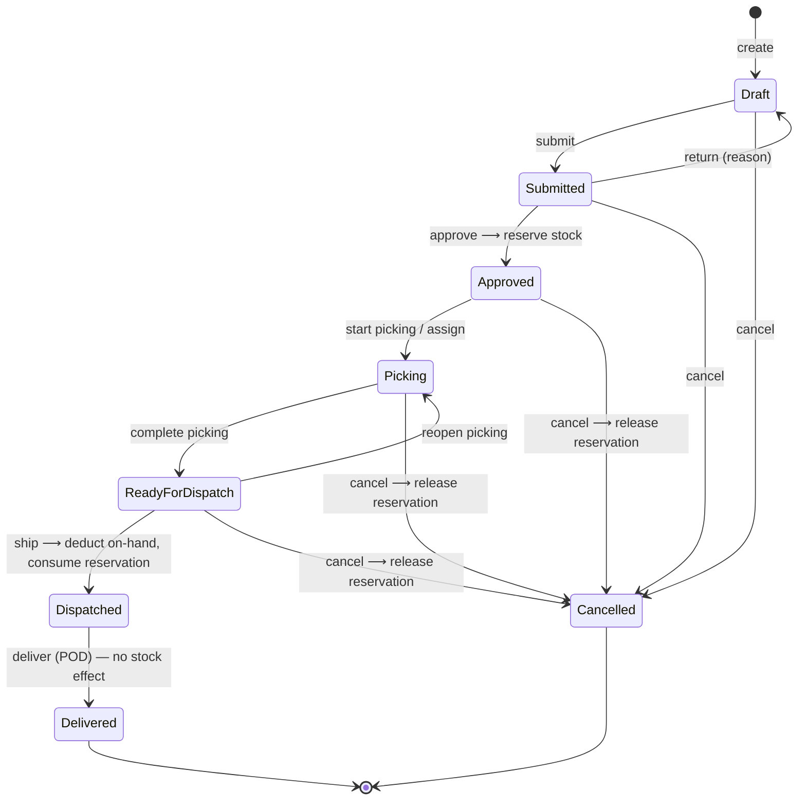

# 03 — Inventory Accounting Rules and Dispatch State Machine

Status: **Draft for review (Phase 1)**

## Part A — Inventory accounting

### A1. Quantities and invariants

For every balance row (warehouse × location × product × lot), with quantities in base units:

| Invariant | Enforced by |
|---|---|
| `available = on_hand − reserved` | Generated column; never stored separately |
| `on_hand ≥ 0` (no negative stock) | DB CHECK + service check |
| `0 ≤ reserved ≤ on_hand` | DB CHECK + service check |
| `on_hand = Σ movement.quantity` for the balance | Nightly reconciliation job + integration tests |
| `reserved = Σ outstanding open reservations` | Nightly reconciliation job + integration tests |
| A document line posts at most once per movement type | UNIQUE (source_type, source_line_id, movement_type) |

The reconciliation job never "fixes" data. It logs, alerts and raises a manager notification.

### A2. Effect of each operation

| Operation | on_hand | reserved | Ledger row | Permission |
|---|---|---|---|---|
| Receipt **draft** / edit | — | — | — | inventory.receive |
| Receipt **post** | + received | — | RECEIPT | inventory.receive.post |
| Receipt **reverse** (whole posted receipt) | − received (fails if it would break `reserved ≤ on_hand`) | — | RECEIPT_REVERSAL | inventory.receive.post |
| Adjustment **post** | ± delta | — | ADJUSTMENT_IN/OUT | inventory.adjust.approve |
| Dispatch **approve** | — | + requested | (reservation rows) | dispatches.approve |
| Dispatch **ship** | − shipped | − shipped (consumed) | DISPATCH | dispatches.ship |
| Release reservation (cancel / close short) | — | − outstanding | (reservation rows) | dispatches.cancel / ship |
| Dispatch **deliver** | — | — | — | dispatches.deliver |
| Bin move / put-away (v1) | −qty at source bin, +qty at target bin (same transaction, unreserved qty only) | — | MOVE_OUT / MOVE_IN | inventory.transfer |
| Transfer ship / receive (future) | −qty at source / +qty at destination | — | TRANSFER_OUT / TRANSFER_IN | inventory.transfer |

Picking does **not** move stock in the ledger, because the goods are still in the building. It records `picked_qty` against the specific reservation (bin + lot). The stock stays on its source bin balance, shown as reserved, until shipment deducts it. This keeps v1 simple. Moving picked goods to a DOCK location can be added later if cycle counts need it (Q19).

### A2b. Lots, expiry and pack units

* **Units:** users can enter or scan in any `ProductUnit` (e.g. 2 cartons). The API converts to base units (`2 × 12 = 24`) and stores only base units. Quantities that don't convert to whole base units, where the base unit allows no decimals, are rejected.
* **Lots:** lot-tracked products require a lot on receipt, adjustment, move and pick. Non-lot products use `lot_id = null`.
* **Expiry:** at approval, reservations are allocated **FEFO**: earliest expiry first, then oldest receipt. Lots that are expired (expiry < requested dispatch date + configurable minimum remaining shelf life), QUARANTINE or BLOCKED are never allocated. Stock in non-pickable locations (RECEIVING, QUARANTINE) is not allocated either.
* **Expiry alerts:** a daily job flags lots expiring within N days (setting) on the dashboard. Expired stock is moved to QUARANTINE by a manager action (an adjustment or bin move), never automatically.

### A3. Concurrency protocol (every stock-changing command)

```
BEGIN (READ COMMITTED)
  1. Load + lock the document:  SELECT ... FROM dispatch WHERE id=@id FOR UPDATE
  2. Check state (e.g. status = 'Submitted'); otherwise → 409 Conflict
  3. Lock affected balance rows in a deterministic order (product_id, balance id):
       SELECT ... FROM inventory_balance WHERE ... ORDER BY product_id FOR UPDATE
  4. Validate quantities against the *locked* values
  5. Write balance changes + movement / reservation rows + status history + audit
COMMIT
```

* Row locks serialize competing approvals and shipments on the same stock. The fixed lock order prevents deadlocks.
* DB CHECK constraints are the last line of defence if application code is wrong.
* EF Core `xmin` concurrency tokens protect ordinary edits (e.g. two people editing the same draft), returning 409 with a "reload" message.
* A CHECK or unique violation is translated to ProblemDetails 409 and is never a 500.

### A4. Idempotency

* Every POST command (`approve`, `ship`, `post`, `pick`…) accepts an `Idempotency-Key` header. The first response is stored in `IdempotencyRecord`. A retry with the same key and body returns the stored response without re-executing. The same key with a different body returns 422.
* Natural idempotency adds a second layer: shipping a dispatch that is already `Dispatched` returns 409, and the ledger's unique constraint makes double-posting impossible even if both layers were bypassed.
* Pick scans carry a client `scanId` with a unique constraint.

### A5. Receipts

Draft → **Posted** (once) → optionally **Reversed** (whole document, auditable). There is no editing after posting. Corrections go through a reversal plus a new receipt, or a stock adjustment. Posting validates active products, warehouse access and `received_qty > 0`.

### A6. Adjustments

A reason code is required. If |value or qty| exceeds a configured threshold (Q8), status goes to **PendingApproval**, and the requester cannot approve their own adjustment. An adjustment cannot reduce `on_hand` below `reserved`; the stock must be un-reserved first.

---

## Part B — Dispatch state machine



`Dispatched` and `Delivered` cannot be cancelled. Shipped goods come back only through a future **Return** document (`RETURN_IN` movement).

### B1. Transition rules

| Command (`POST /api/v1/dispatches/{id}/…`) | From → To | Validation | Effect |
|---|---|---|---|
| `submit` | Draft → Submitted | ≥ 1 line; qty > 0; products active; customer and address active; user has warehouse access; no duplicate products | Snapshot delivery address |
| `return` | Submitted → Draft | reason required | — |
| `approve` | Submitted → Approved | `dispatches.approve`; approver ≠ creator (setting); **eligible available ≥ requested for every line** (locked; eligible = pickable bin, released, not expired) | Allocate FEFO across bins/lots and create reservations atomically, all lines or none. If any line is short → 409 listing shortages. Records approver and timestamp. |
| `start-picking` | Approved → Picking | `dispatches.pick`; optional assignee | Create picking task |
| `pick` | (stays Picking) | Bin scan + product barcode (pack barcode gives the quantity); lot entered or scanned; must match an open reservation for this dispatch; `picked + qty ≤ reserved` for that reservation (over-pick blocked); unique `scanId` | Increment `picked_qty`, record PickConfirmation |
| `swap-allocation` | (stays Picking) | Operator picks a different bin/lot than allocated: the new balance must be eligible and available | In one transaction, release the old reservation part and reserve the new one; audited |
| `report-discrepancy` | (stays Picking) | type + qty | DispatchDiscrepancy row |
| `complete-picking` | Picking → ReadyForDispatch | Every line fully picked, **or** short lines acknowledged (partial setting) | — |
| `reopen-picking` | ReadyForDispatch → Picking | manager | — |
| `ship` | ReadyForDispatch → Dispatched | `dispatches.ship`; per line `shipped_qty ≤ picked_qty ≤ reserved`; carrier/tracking if required; **remainder decision** for short lines | One transaction: `on_hand −= shipped`, `reserved −= shipped`, DISPATCH movements, reservation consumed, status history, audit |
| `deliver` | Dispatched → Delivered | `dispatches.deliver`; delivered_at, receiver name; POD file if required | Record ProofOfDelivery. **No stock effect.** |
| `cancel` | Draft…ReadyForDispatch → Cancelled | `dispatches.cancel`; reason required | Release all outstanding reservations |

Every transition writes a `DispatchStatusHistory` row and an `AuditLog` row in the same transaction. The status column is never updated by a generic PUT; draft edits (`PUT /dispatches/{id}`) are allowed only in `Draft`.

### B2. Partial shipment (proposal, see Q5)

When `shipped_qty < requested_qty` on any line, the shipper must choose one of two options:

1. **Close short**: the outstanding reservation is released and the dispatch ends as `Dispatched` with shipped < requested, which shows on the discrepancy report.
2. **Backorder**: the outstanding reservation is transferred to a new child dispatch (`backorder_of_id` = original) created in `Approved` state for the remaining quantity. The original becomes `Dispatched`.

This keeps the rule "one dispatch ships exactly once" (simple, auditable, idempotent) while still supporting split deliveries. Each child dispatch has its own delivery confirmation.

### B3. Barcode during picking

The mobile pick list shows each line's allocated bin + lot, sorted by bin code (walk order). The operator scans the **bin label**, then the **product/pack barcode**, then confirms the lot, then the quantity. GS1-128 / GS1 DataMatrix labels carrying lot (AI 10) and expiry (AI 17) are parsed automatically if your suppliers use them (Q10).

Scan → `GET /api/v1/product-barcodes/{value}` (returns product + pack factor only if active), then `POST /dispatches/{id}/pick { scanId, locationCode, barcode, lotNo, qty }`. The server re-resolves the barcode itself; the product id from the client is not trusted. Responses:
* Unknown barcode → 404 *"Barcode not recognised"*. Inactive product → 422.
* Product not on this dispatch → 422 *"Not on this dispatch"* (offer to report UNEXPECTED).
* Quantity exceeds remaining → 422 with remaining qty.
* Same scanId again → 200 with the original result (no double count).
